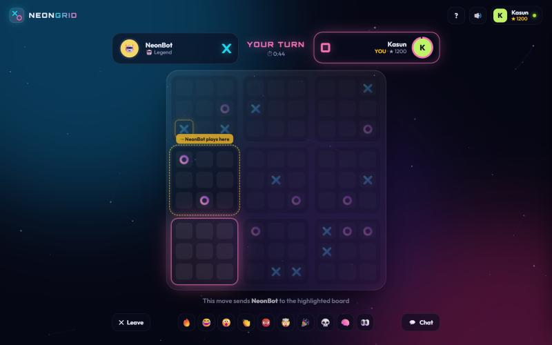
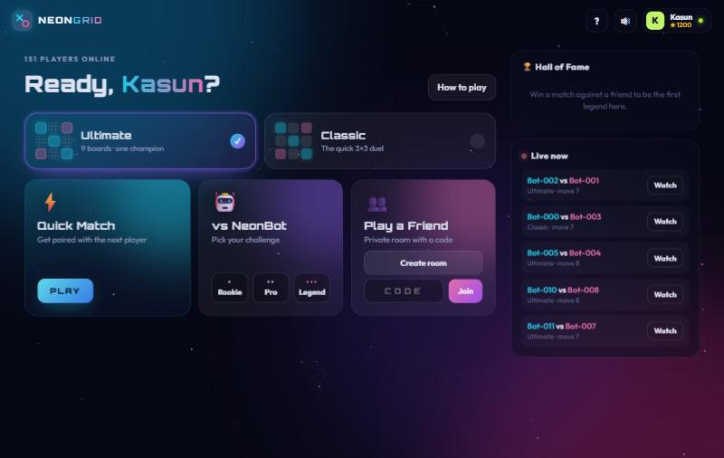
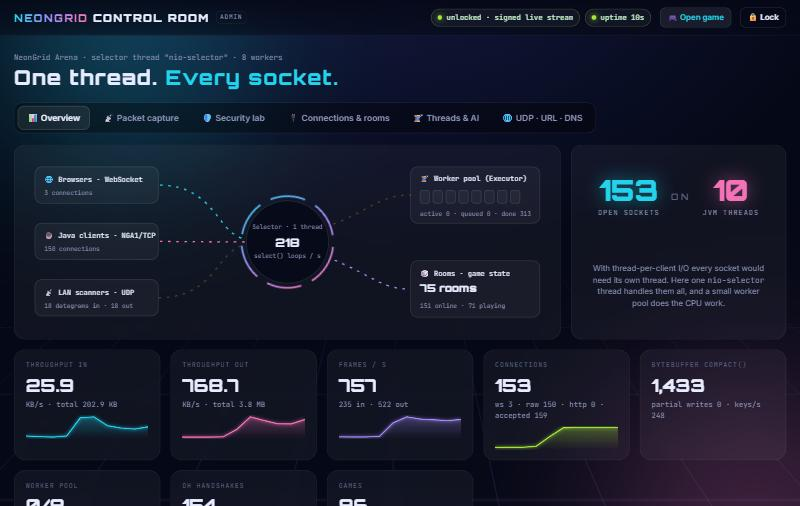

# NeonGrid Arena

**Real-time multiplayer Ultimate Tic-Tac-Toe, built on a Java NIO server written from scratch.**

Network Programming · Assignment 02. One `Selector` thread serves HTTP, WebSocket, a binary TCP protocol and UDP discovery at the same time, and every message is signed with a key agreed by Diffie-Hellman. Plain JDK only: no frameworks, no libraries.



---

## Features

**For players** (`http://<server>:8080/`)
- Ultimate 9×9 and Classic 3×3 Tic-Tac-Toe
- Quick Match (server matchmaking), private friend rooms with a code, invite link and **QR code**, spectating
- **NeonBot** AI opponent at three levels (Rookie / Pro / Legend)
- Glowing "where you can play" boards, a move preview, and an animated how-to-play guide
- Chat, emoji reactions, rematch, turn timer, Elo **Hall of Fame**
- Works on desktop and phones; reconnects automatically and keeps your seat

**For evaluators / admins** (`http://<server>:8080/control`, password protected)
- Live dashboard: open sockets vs threads, throughput, selector loops, worker pool
- Server-side packet capture (every frame with its sequence number and HMAC)
- Security lab: 9 real attacks (replay, tamper, forgery, flood, cheat, …), all blocked by the server
- Connections, rooms, AI telemetry, UDP / URL / DNS tools

| Home | Friend room (phone) | Control Room |
|---|---|---|
|  |  |  |

---

## Quick start

Needs **JDK 17 or newer** (`java -version`). In PowerShell, inside this folder:

```powershell
Set-ExecutionPolicy -Scope Process Bypass
```
```powershell
./scripts/build.ps1
```
```powershell
./scripts/run-server.ps1
```

| Open | |
|---|---|
| `http://localhost:8080/` | the game (open two tabs for two players) |
| `http://<LAN-IP>:8080/` | from a phone on the same Wi-Fi (the server prints the address) |
| `http://localhost:8080/control` | Control Room. Password **`arena-admin`** (change with `--admin-pass`) |

Optional extras:

```powershell
./scripts/run-client.ps1
```
```powershell
./scripts/run-bots.ps1 --bots 300
```

The first is a terminal player that finds the server by UDP broadcast; the second is a load test with 300 bots.

On macOS or Linux, run `sh scripts/build.sh`, then `java -jar build/neongrid-arena.jar`.

Full step-by-step instructions and troubleshooting: **[docs/SETUP.md](docs/SETUP.md)**

---

## Folder structure

```
NeonGridArena/
├── src/arena/                 Java source code (server, game, clients)
│   ├── server/                NIO server: Reactor, Connection, Http, WebSocket, Discovery (UDP),
│   │                          Lobby, SecureHandshake, AdminConsole, Room, Session, Leaderboard, Metrics, NetUtil, ArenaServer (main)
│   ├── game/                  Board (game rules) and AiPlayer (NeonBot AI)
│   ├── common/                Crypto (Diffie-Hellman, SHA-256, HMAC), SecureLink, Json
│   └── client/                ConsoleClient, BotSwarm (load test), LanScanner (UDP), Handshake
├── web/                       Browser front-end, served by the Java server
│   ├── index.html             the game
│   ├── control.html           the Network Control Room
│   ├── css/                   game.css (game) · control.css (Control Room)
│   └── js/                    game.js · control.js · net.js (secure WebSocket shared by both)
├── scripts/                   build.ps1 / build.sh · run-server · run-client · run-bots · package
├── docs/
│   ├── SETUP.md               setup guide for teammates
│   └── report/                project report and team guide (HTML sources, PDFs, screenshots)
├── .gitignore
└── README.md
```

`build/` (compiled classes and the jar) and `data/` (the saved leaderboard) are created at runtime and are not committed.

---

## Network programming concepts

| # | Concept | Main code | Owner |
|---|---|---|---|
| 1 | **Java NIO**: Selector, channels, ByteBuffer `flip`/`compact`, partial writes | `server/Reactor.java`, `server/Connection.java`, `client/BotSwarm.java` | Member A |
| 2 | **TCP & protocols**: HTTP, hand-written WebSocket, NGA1 frames, blocking `Socket` client | `server/Http.java`, `server/WebSocket.java`, `client/ConsoleClient.java` | Member B |
| 3 | **Multithreading**: ExecutorService, `Callable`/`Future`, `synchronized` | `game/AiPlayer.java`, `Reactor.submit()`, `server/Leaderboard.java` | Member C |
| 4 | **UDP**: DatagramChannel on the selector, broadcast discovery | `server/Discovery.java`, `client/LanScanner.java` | Member D |
| 5 | **Addressing, URLs & DNS**: LAN IPs, invite links, `java.net.URI`, DNS lookups | `server/Http.java`, `server/NetUtil.java` | Member B |
| 6 | **Security**: Diffie-Hellman, HMAC-SHA256, replay protection, rate limiting, admin challenge-response | `common/Crypto.java`, `common/SecureLink.java`, `web/js/net.js`, `server/Lobby.java` | Member E |

How each part works, a demo script and likely viva questions per member: **[docs/report/NeonGrid-Team-Guide.pdf](docs/report/NeonGrid-Team-Guide.pdf)**.
Project report: **[docs/report/NeonGrid-Arena-Report.pdf](docs/report/NeonGrid-Arena-Report.pdf)**.

---

## How to play Ultimate

1. The board is made of 9 small boards. Three in a row inside a small board claims it.
2. **Your move sends your opponent:** if you play in the top-right cell of any board, they must play in the top-right board, which glows.
3. If you're sent to a board that's already finished, you get a free move anywhere.
4. Claim three small boards in a row to win. Running out of time (45 s per move) or leaving counts as a loss.

---

## Working on the project

See **[CONTRIBUTING.md](CONTRIBUTING.md)** for how to make changes, create a branch and open a pull request.

## Team

| Member | Name | Part |
|---|---|---|
| A | *name* | Java NIO reactor |
| B | *name* | TCP, WebSocket, URL & DNS |
| C | *name* | Multithreading & AI |
| D | *name* | UDP discovery |
| E | *name* | Security |
